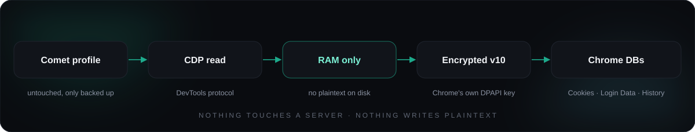

<div align="center">



<br>

[](https://github.com/usexless/comet-to-chrome-migrate/releases/latest)
[](#requirements)
[](https://nodejs.org/)
[](#requirements)
[](LICENSE)

**Comet imports. It never lets you leave.** This moves your cookies, passwords,
history and autofill into Chrome — one click, no dialogs, no Windows Hello,
no plaintext ever written to disk.

[Download the release](https://github.com/usexless/comet-to-chrome-migrate/releases/latest) · [Landing page](https://usexless.github.io/comet-to-chrome-migrate/) · [Report an issue](https://github.com/usexless/comet-to-chrome-migrate/issues)

</div>

<br>

## Why this exists

[Comet](https://comet.perplexity.ai/) (Perplexity's Chromium fork) can import
data *from* Chrome, but offers no way *out*. Switching back meant losing every
login session, every saved password, six months of history.

This tool walks into both profiles directly: it reads Comet over the DevTools
protocol, encrypts everything in Chrome's own format with Chrome's own key, and
writes it where Chrome looks. Chrome then treats the data as its own — because
cryptographically, it is.

## What moves over

| | Data | Result in Chrome |
|:-:|---|---|
| ✅ | **Cookies / sessions** | Still signed in everywhere, session cookies get a 30-day grace period |
| ✅ | **Saved passwords** | Written as real v10 blobs, verified by a fill-and-compare roundtrip |
| ✅ | **History** | Merged by URL + timestamp, no duplicates |
| ✅ | **Downloads** | The `chrome://downloads` list, paths included |
| ✅ | **Autofill & search engines** | Form entries and custom search engines |
| ✅ | **Bookmarks** | ❌ Comet has no export for them — nothing to migrate |

No dialogs, no clicking, no Windows Hello. **No plaintext file is ever
written** — passwords and cookies exist only in memory and end up encrypted in
Chrome's own databases.

## Quick start

```bash
# 1. Install Node.js 22+          https://nodejs.org/
# 2. Start Comet and Chrome once  (so both profiles exist)
# 3. Download + unpack the release
# 4. Double-click:
```

<div align="center">

| `Migrate everything.cmd` | `Comet to Chrome.cmd` |
|:---:|:---:|
| One click, runs everything | Opens a small window |
| Cookies → passwords → history | Pick one card or hit **Migrate everything** |
| Keeps the console open until done | Live log, same engine underneath |

</div>

From a terminal, for full control:

```bash
node migrate.js cookies      # sessions
node migrate.js passwords    # passwords
node migrate.js history      # history, downloads, search terms, autofill
node migrate.js all          # everything, in that order
```

Both browsers may stay open: the tool closes them gracefully and restarts them
when it needs to.

## How it works

<div align="center">

</div>

**The password problem** — Chrome's "re-authenticate before filling" is, on
Windows, only a preference that is off by default; a normal autofill never
triggers Windows Hello. So Comet is served a tiny login page *on the original
origin* via `Fetch.fulfillRequest` (no network, no redirects), and focusing the
password field plus arrow-down and Enter makes Comet itself write the saved
password into the field. The value is read in memory and immediately encrypted
as a v10 blob with Chrome's DPAPI key (AES-256-GCM).

**The cookie problem** — Chrome refuses `--remote-debugging-port` on the
default profile, so no CDP import. Instead cookies are written straight into
Chrome's cookie DB, encrypted with the key from `Local State`
(`os_crypt.encrypted_key`). Chrome's cookie plaintext is
`sha256(host_key) || value` — without that host binding, Chrome silently drops
every cookie on the next start. Session cookies (`has_expires = 0`) would be
deleted on the first clean exit, so they are imported with a 30-day expiry.

<details>
<summary><b>Verification: how do I know it worked?</b></summary>

<br>

- After the cookie import, one written cookie is decrypted again and compared
  byte-for-byte with the original.
- After the password import, a **copy of the Chrome profile** is started and
  Chrome itself fills the entries again; values are compared by SHA-256. This
  runs in the copy, never in your real profile.
- Chrome's `Login Data` size is checked after writing; if it shrank, the backup
  is restored and the run aborts.

</details>

<details>
<summary><b>Safety net: what can't go wrong</b></summary>

<br>

- Every affected file from Comet and Chrome is backed up before a run, to
  `%LOCALAPPDATA%\comet-chrome-migrate\backup\<timestamp>\`.
- Comet's profile is **never modified** — only read and backed up.
- Browsers are only started briefly, with sync and background networking
  disabled, window off-screen.
- A second run is idempotent: nothing is duplicated.

</details>

## FAQ

<details>
<summary>Will it ask for Windows Hello or a PIN?</summary>

<br>

No. The tool never opens the password manager UI and never touches the
biometric prompt. Fill-then-read happens inside a regular page load.

</details>

<details>
<summary>Does it work when Chrome is already signed in and synced?</summary>

<br>

Yes. Existing Chrome data stays; migrated entries are merged. Sync may later
push the new history and passwords to your other devices — usually exactly what
you want.

</details>

<details>
<summary>What about bookmarks and extensions?</summary>

<br>

Not migrated. Comet ships no bookmark export, and extensions are Chromium
web-store extensions you would reinstall anyway. History, sessions and
passwords are the parts that hurt to lose.

</details>

<details>
<summary>Which profiles are supported?</summary>

<br>

The `Default` profile of both browsers. Multi-profile setups are detected as
unsupported rather than guessed wrong.

</details>

<details>
<summary>Is this allowed? Is it safe?</summary>

<br>

It is your machine and your data. Nothing is bypassed that protects someone
else — the encryption keys are yours, stored by Windows for your user account.
No telemetry, no network calls beyond closing and opening your browsers.
Unofficial tool, use at your own risk, MIT licensed. The whole thing is about
1,500 lines of readable code with zero dependencies.

</details>

## Requirements

- Windows 10/11
- [Node.js](https://nodejs.org/) 22 or newer (uses the built-in `node:sqlite`)
- Comet and Chrome installed, each started at least once

## Limits

- `Default` profile only.
- Bookmarks are not migrated (Comet has no export for them).
- Password extraction depends on Comet's autofill still behaving; if Perplexity
  changes it, entries are skipped and counted — nothing disappears silently.
- Cookies Chrome interprets differently (e.g. `SameSite=None` without `Secure`)
  may be rejected; failures are logged.

---

<div align="center">

**Built for people who like owning their data.**

<a href="https://github.com/usexless/comet-to-chrome-migrate/releases/latest"></a>

<br>

<sub>Licensed under <a href="LICENSE">MIT</a> · not affiliated with Perplexity or Google</sub>

</div>
